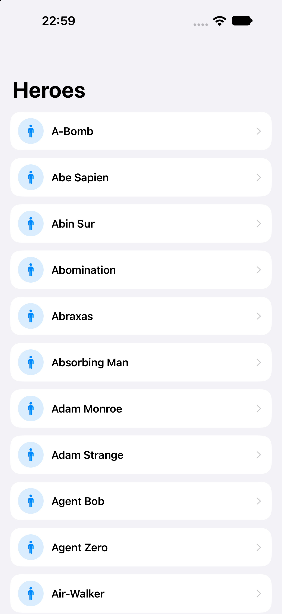
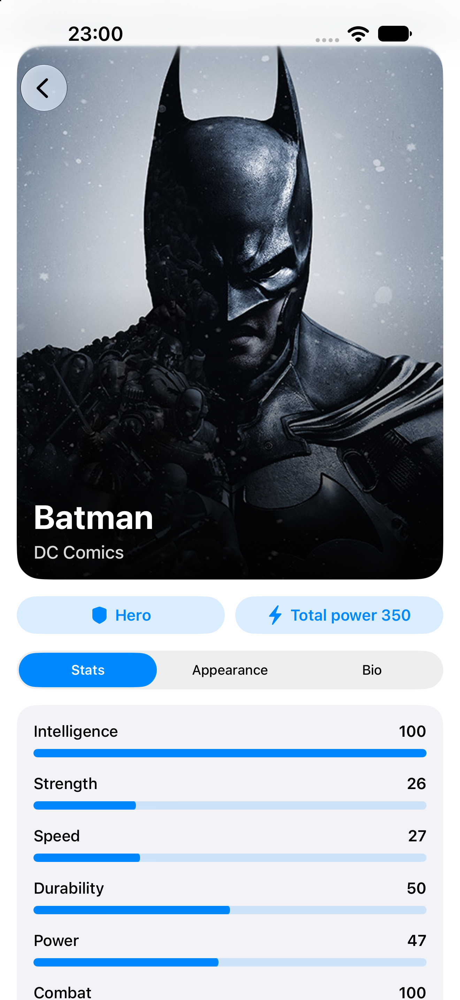
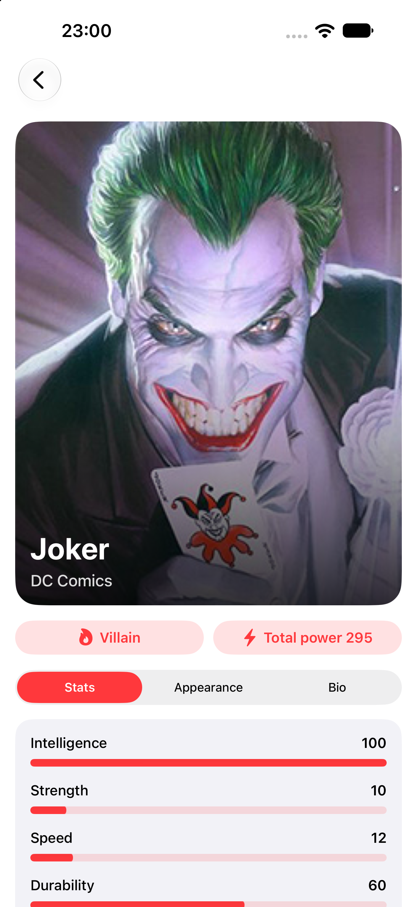

# Superheroes

iOS lab: List & Detail with a Real API.

A two-screen UIKit app. The first screen loads all heroes from the [Superhero API](https://github.com/akabab/superhero-api) and shows them in a table view. Tapping a hero opens a detail page with the hero's picture and info about them.

- UI is made in `Main.storyboard`, networking is in Swift files
- No libraries, only `URLSession` + `Codable`
- Works in light and dark mode

## Screens

**Heroes list**
- `UITableView` inside a `UINavigationController` with the large title "Heroes"
- `all.json` is loaded once in `viewDidLoad`, a big activity indicator spins while it loads
- If the request fails there is an alert with a Retry button
- Every cell is a rounded card with the hero name and a gender badge (SF Symbol in a coloured circle):
  - Male: blue circle, `figure.stand`
  - Female: pink circle, `figure.stand.dress`
  - Unknown (`"-"`): grey circle, `questionmark`
- When you press a cell, the card shrinks a bit and springs back (`setHighlighted` + spring animation)

**Hero detail**
- Big rounded image (`lg`, or `md` if there's no `lg`) with a dark gradient, the name and publisher on top of it
- A placeholder icon is shown until the image downloads
- Tap the image to switch between "fill" and "fit" and see the whole picture
- The whole page uses one accent colour based on alignment: blue for heroes, red for villains, orange for neutral
- A segmented control switches between three cards: **Stats**, **Appearance** and **Bio**
- The hero comes from the list in `prepare(for:sender:)`, so nothing is downloaded a second time (only the picture)

## Properties I chose

18 properties from 4 groups (powerstats, appearance, biography, work):

| # | Property | Group | How it is shown |
|---|----------|-------|-----------------|
| 1 | intelligence | powerstats | Stats tab: number + animated progress bar |
| 2 | strength | powerstats | Stats tab: number + animated progress bar |
| 3 | speed | powerstats | Stats tab: number + animated progress bar |
| 4 | durability | powerstats | Stats tab: number + animated progress bar |
| 5 | power | powerstats | Stats tab: number + animated progress bar |
| 6 | combat | powerstats | Stats tab: number + animated progress bar |
| 7 | gender | appearance | Appearance tab, row |
| 8 | race | appearance | Appearance tab, row |
| 9 | height | appearance | Appearance tab, row, metric and imperial together (`203 cm · 6'8`) |
| 10 | weight | appearance | Appearance tab, row (`441 kg · 980 lb`) |
| 11 | eyeColor | appearance | Appearance tab, row |
| 12 | hairColor | appearance | Appearance tab, row |
| 13 | fullName | biography | Bio tab |
| 14 | placeOfBirth | biography | Bio tab |
| 15 | firstAppearance | biography | Bio tab |
| 16 | publisher | biography | Subtitle under the name on the image |
| 17 | alignment | biography | Chip under the image (Hero / Villain / Neutral) + accent colour of the page |
| 18 | occupation | work | Bio tab |

There is also a "Total power" chip, which is the sum of all six powerstats.

The bars animate from 0 when the page opens and every time you go back to the Stats tab.

## Messy data

- `"-"`, `null`, empty strings, `"0 cm"` and `"0 kg"` are shown as **Unknown**
- If the publisher is missing, the subtitle is hidden
- Height and weight show only the part that is known. If neither part is known, they show Unknown
- All text fields in the models are optional, so `null` doesn't break decoding

## How the data travels

1. `HeroesViewController` calls `HeroService.shared.fetchHeroes` in `viewDidLoad` and starts the activity indicator
2. `HeroService` creates `URLSession.shared.dataTask` for `all.json`. The completion handler runs on a background thread
3. There it checks the error and the status code, then decodes `[Hero]` with `JSONDecoder`
4. The result is sent back with `DispatchQueue.main.async`, because UIKit can only be used from the main thread
5. The controller saves the array, stops the indicator and calls `tableView.reloadData()`
6. `cellForRowAt` dequeues a `HeroCell` and calls `configure(with:)`. The cell has no async work (only name and gender), so reused cells can't show wrong data when you scroll fast
7. On tap, the segue `showDetail` passes the selected `Hero` to `HeroDetailViewController`
8. The detail page downloads only the image data with `dataTask`, and on the main thread does `UIImage(data:)`

The models are marked `nonisolated` because the project's default actor isolation is `MainActor`, and decoding happens on a background thread.

## Project structure

```
Superheroes/
├── Models/
│   ├── Hero.swift
│   └── Hero+Style.swift
├── Services/
│   └── HeroService.swift
├── Controllers/
│   ├── HeroesViewController.swift
│   └── HeroDetailViewController.swift
├── Views/
│   └── HeroCell.swift
└── Base.lproj/
    └── Main.storyboard
```

## Screenshots

| List | Detail (hero) | Detail (villain) |
|------|---------------|------------------|
|  |  |  |

## How to run

Open `Superheroes.xcodeproj` in Xcode and run on any iPhone simulator. You need an internet connection.
